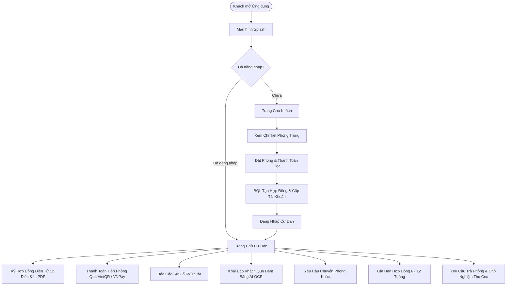

# 📱 Ứng Dụng Di Động Quản Lý Nhà Trọ Kiêu Giang (KLCN Mobile)

> Ứng dụng di động thông minh dành cho **Cư Dân** và **Khách Thuê Phòng** thuộc Hệ Thống Nhà Trọ Kiêu Giang, được xây dựng trên nền tảng **Flutter** kết hợp **Supabase BaaS**, tích hợp AI OCR nhận diện CCCD, quét chỉ số điện nước, thanh toán VietQR / VNPay và ký kết hợp đồng số pháp lý.

---

## 📌 Mục Lục
1. [Giới Thiệu Chung](#-giới-thiệu-chung)
2. [Các Tính Năng Nổi Bật](#-các-tính-năng-nổi-bật)
3. [Công Nghệ & Thư Viện Sử Dụng](#-công-nghệ--thư-viện-sử-dụng)
4. [Cấu Trúc Thư Mục Dự Án](#-cấu-trúc-thư-mục-dự-án)
5. [Yêu Cầu Môi Trường](#-yêu-cầu-môi-trường)
6. [Hướng Dẫn Cài Đặt & Chạy Ứng Dụng](#-hướng-dẫn-cài-đặt--chạy-ứng-dụng)
7. [Quy Trình Nghiệp Vụ Chính](#-quy-trình-nghiệp-vụ-chính)

---

## 📖 Giới Thiệu Chung

Ứng dụng **Nhà Trọ Kiêu Giang (Mobile App)** phục vụ 2 nhóm đối tượng người dùng chính:
- **Khách thuê tiềm năng (Guest):** Dễ dàng tìm kiếm phòng trống theo nhu cầu, xem tiện ích nội thất, bảng giá điện nước, thực hiện giữ chỗ trực tuyến và thanh toán tiền cọc bảo đảm.
- **Cư dân đang thuê (Tenant):** Quản lý toàn diện quá trình lưu trú: ký hợp đồng điện tử, nhận thông báo hóa đơn hàng tháng, quét mã VietQR tự động thanh toán, theo dõi chỉ số điện nước, đăng ký khách lưu trú qua đêm, báo hỏng hóc bảo trì, yêu cầu chuyển phòng, gia hạn hoặc chấm dứt hợp đồng.

---

## ✨ Các Tính Năng Nổi Bật

### 1. Phân Hệ Dành Cho Khách Thuê (Guest Mode)
- **Danh sách phòng & Chi tiết phòng:** Duyệt danh sách phòng theo tòa nhà, tầng, diện tích, giá thuê và hình ảnh thực tế.
- **Đặt phòng & Giữ chỗ trực tuyến:** Điền thông tin người thuê, chọn ngày dọn vào, tự động tính tiền cọc thế chân.
- **Thanh toán cọc đa kênh:** Quét mã VietQR chuyển khoản nhanh hoặc cổng thanh toán VNPay; tra cứu lịch sử đơn giữ chỗ.

### 2. Phân Hệ Dành Cho Cư Dân (Tenant Mode)
- **Trang chủ Cư dân (Dashboard):** 
  - Xem thông tin phòng hiện tại, hạn hợp đồng, số ngày còn lại.
  - Danh sách thành viên đang ở cùng, phương tiện xe máy đăng ký.
  - Hóa đơn dịch vụ hàng tháng và trạng thái thanh toán.
- **Hợp đồng điện tử 12 Điều chuẩn Luật Nhà ở & Kinh doanh BĐS 2023:**
  - Ký chữ ký tay điện tử trực tiếp trên màn hình cảm ứng.
  - Xem trực quan các điều khoản pháp lý quan trọng (thanh toán, trách nhiệm 2 bên, bảo lưu cọc, PCCC).
  - Xuất file **PDF Hợp Đồng Thuê Nhà Ở** và **Phụ Lục Hợp Đồng Thuê Phòng** chuẩn in ấn kèm chữ ký số 2 bên.
- **Thanh toán hóa đơn thông minh:**
  - Tự động sinh mã VietQR chuẩn NAPAS 247 đúng số tiền và nội dung chuyển khoản.
  - Tích hợp cổng thanh toán trực tuyến **VNPay (Sandbox/Production)** qua WebView.
  - Tải ảnh ủy nhiệm chi/biên lai xác nhận chuyển khoản cho BQL đối soát.
  - Hiệu ứng âm thanh thông báo thanh toán thành công.
- **Gia hạn hợp đồng thuê:**
  - Ràng buộc tự động: Chỉ kích hoạt khi hợp đồng còn $\le 30$ ngày trước khi hết hạn.
  - Chọn kỳ hạn linh hoạt từ 6 đến 12 tháng.
  - Tự động tạo phụ lục hợp đồng và lưu trữ lịch sử gia hạn.
- **Yêu cầu đổi / Chuyển phòng:**
  - Kiểm tra điều kiện lưu trú tối thiểu ($\ge 60$ ngày).
  - Tìm kiếm phòng trống có sẵn, so sánh chênh lệch giá thuê & tiền cọc.
  - Gửi yêu cầu chuyển phòng lên Ban Quản Lý và theo dõi tiến độ duyệt.
- **Yêu cầu trả phòng / Thanh lý hợp đồng:**
  - Giao diện tinh gọn, tối giản (Chọn ngày dọn đi, ghi chú lý do).
  - Tự động kiểm tra khoảng cách ngày dọn đi: Chấm dứt trước hạn tự động tính hoàn cọc 0đ; đúng hạn hiển thị hoàn cọc theo hợp đồng.
  - Popup xác nhận hiện đại, không che khuất thông tin thẻ chi tiết đơn.
- **Tiện ích lưu trú mở rộng:**
  - **Quét CCCD bằng AI (Google ML Kit):** Tự động bóc tách họ tên, số CCCD, ngày sinh khi đăng ký khách qua đêm.
  - **Đăng ký khách qua đêm:** Gửi thông tin đăng ký lưu trú tạm thời lên BQL trước 22h00.
  - **Báo sự cố kỹ thuật:** Chụp ảnh hỏng hóc (máy lạnh, bóng đèn, ống nước...), chọn mức độ khẩn cấp và theo dõi tiến độ sửa chữa.
  - **Chỉ số điện nước:** Quét ảnh công tơ điện tử/đồng hồ nước và theo dõi biểu đồ tiêu thụ hàng tháng.

---

## 🛠 Công Nghệ & Thư Viện Sử Dụng

| Danh Mục | Thư Viện / Công Nghệ | Mục Đích |
|---|---|---|
| **Core Framework** | Flutter SDK 3.x, Dart 3.x | Phát triển ứng dụng đa nền tảng |
| **Backend & Database** | `supabase_flutter` | Authentication, PostgreSQL Database, Storage Bucket, Realtime |
| **Thị giác máy tính (AI)** | `google_mlkit_text_recognition` | Nhận diện ký tự quang học (OCR) trên thẻ CCCD & công tơ |
| **Thanh toán** | `qr_flutter`, `webview_flutter` | Tạo mã VietQR chuẩn quốc gia, tích hợp cổng thanh toán VNPay |
| **Tài liệu & In ấn** | `pdf`, `printing` | Tạo và in file PDF Hợp đồng 12 điều & Phụ lục kèm chữ ký |
| **Chữ ký tay** | Custom Canvas Painter | Ký tên trực tiếp trên màn hình cảm ứng điện thoại |
| **Thông báo** | `flutter_local_notifications` | Bắn thông báo đẩy hệ thống khi có cập nhật hợp đồng, hóa đơn |
| **Lưu trữ cục bộ** | `shared_preferences` | Lưu trạng thái phiên làm việc, cờ thông báo, tài khoản ghi nhớ |
| **Bảo mật** | `bcrypt`, `crypto` | Mã hóa dữ liệu và kiểm tra toàn vẹn chữ ký thanh toán |

---

## 📂 Cấu Trúc Thư Mục Dự Án

```text
KLCN_Mobile/
├── android/                         # Cấu hình dự án native Android
├── assets/                          # Tài nguyên tĩnh
│   ├── fonts/                       # Phông chữ Unicode tiếng Việt (Arial, Arial Bold)
│   └── images/                      # Logo, chữ ký mặc định Bên A, banner
├── ios/                             # Cấu hình dự án native iOS
├── lib/
│   ├── main.dart                    # Điểm khởi chạy ứng dụng (Khởi tạo Supabase & Notifications)
│   │
│   ├── core/                        # Thành phần lõi dùng chung toàn dự án
│   │   ├── constants/               # Hằng số giao diện, bảng màu chính (_primary, _bgLight...)
│   │   │   └── MauSacUngDung.dart
│   │   ├── services/                # Các dịch vụ xử lý nghiệp vụ & kết nối ngoại vi
│   │   │   ├── DichVuDatCoc.dart           # Xử lý đặt cọc phòng
│   │   │   ├── DichVuLuuDatPhong.dart      # Lưu vết đơn giữ chỗ
│   │   │   ├── DichVuQuetCccd.dart         # OCR đọc thẻ CCCD qua ML Kit
│   │   │   ├── DichVuQuetDongHo.dart       # OCR đọc số đồng hồ điện nước
│   │   │   ├── DichVuSms.dart              # Gửi tin nhắn SMS OTP
│   │   │   ├── DichVuThongBaoHeThong.dart  # Quản lý notification chuông/rung
│   │   │   ├── DichVuXacThuc.dart          # Xác thực tài khoản cư dân & phiên đăng nhập
│   │   │   └── VnPayService.dart           # Tạo URL thanh toán VNPay Sandbox/Real
│   │   ├── utils/                   # Tiện ích định dạng & hỗ trợ
│   │   │   ├── AmThanhThanhToanHelper.dart # Phát âm thanh giao dịch thành công
│   │   │   ├── LienHeHelper.dart           # Mở hotline, Zalo BQL
│   │   │   ├── ThongBaoHelper.dart         # Dialog modal thông báo hiện đại, chống lặp
│   │   │   ├── TienIchDinhDang.dart        # Định dạng tiền tệ VND, ngày tháng dd/MM/yyyy
│   │   │   └── VietQrHelper.dart           # Sinh URL mã QR VietQR NAPAS 247
│   │   └── widgets/                 # Widget dùng chung
│   │       ├── BangKyTay.dart              # Bảng vẽ ký tên cảm ứng
│   │       ├── ChuKyBenAMacDinh.dart       # Dựng chữ ký & con dấu mẫu Bên A
│   │       └── LoadingMeoMeo.dart          # Hoạt cảnh loading chú mèo thân thiện
│   │
│   ├── data/
│   │   └── models/                  # Lớp đối tượng dữ liệu ánh xạ từ Supabase
│   │       ├── KhachLuuTruModel.dart       # Model khách lưu trú
│   │       ├── MoHinhBienBanThanhLy.dart   # Model biên bản thanh lý/trả phòng
│   │       ├── MoHinhDichVu.dart           # Model dịch vụ, hóa đơn, điện nước
│   │       ├── MoHinhGiuCho.dart           # Model đơn đặt phòng/giữ chỗ
│   │       ├── MoHinhHopDong.dart          # Model Hợp đồng, Cư dân, Phụ lục
│   │       ├── MoHinhNguoiDung.dart        # Model tài khoản đăng nhập
│   │       ├── MoHinhPhong.dart            # Model phòng trọ & tòa nhà
│   │       ├── MoHinhPhuongTien.dart       # Model đăng ký xe máy/thẻ xe
│   │       └── MoHinhThongSoPhong.dart     # Model thông số kỹ thuật phòng
│   │
│   └── features/                    # Các màn hình phân theo luồng người dùng
│       ├── auth/                    # Xác thực: Đăng nhập SĐT/mật khẩu, đổi MK lần đầu
│       │   ├── ManHinhDangNhap.dart
│       │   └── ManHinhDoiMatKhauLanDau.dart
│       ├── guest/                   # Luồng khách vãng lai: Tìm phòng, xem chi tiết, đặt cọc
│       │   ├── ManHinhChiTietPhong.dart
│       │   ├── ManHinhDatPhong.dart
│       │   ├── ManHinhDatPhongThanhCong.dart
│       │   ├── ManHinhLichSuDatPhong.dart
│       │   ├── ManHinhThanhToanTheChan.dart
│       │   └── ManHinhTrangChuKhach.dart
│       ├── splash/                  # Màn hình Splash kiểm tra phiên & chuyển hướng
│       │   └── ManHinhKhoiDong.dart
│       └── tenant/                  # Toàn bộ nghiệp vụ cư dân đang thuê phòng
│           ├── ManHinhTrangChuCuDan.dart           # Dashboard chính của cư dân
│           ├── ManHinhChiTietHopDong.dart          # Chi tiết HĐ 12 điều, ký tên & in PDF
│           ├── ManHinhGiaHanHopDong.dart           # Gửi đơn xin gia hạn hợp đồng
│           ├── ManHinhLichSuGiaHanHopDong.dart     # Lịch sử & phụ lục gia hạn
│           ├── ManHinhChamDutHopDong.dart          # Đơn xin trả phòng / thanh lý
│           ├── ManHinhTimKiemChuyenPhong.dart      # Tìm phòng chuyển đến
│           ├── ManHinhChiTietChuyenPhong.dart      # Đơn xin chuyển phòng
│           ├── ManHinhLichSuChuyenPhong.dart       # Lịch sử các lần chuyển phòng
│           ├── ManHinhThanhToan.dart               # Thanh toán hóa đơn (VietQR / VNPay)
│           ├── ManHinhVnPayWebView.dart            # Mở cổng thanh toán VNPay
│           ├── ManHinhTaiLenBienLai.dart           # Tải biên lai chuyển khoản ngân hàng
│           ├── ManHinhLichSuHoaDon.dart            # Lịch sử các hóa đơn tiền phòng
│           ├── ManHinhChiSoDienNuoc.dart           # Theo dõi & quét chỉ số điện nước
│           ├── ManHinhBaoSuCo.dart                 # Gửi phản ánh/sự cố hư hỏng
│           ├── ManHinhDangKyKhachQuaDem.dart       # Đăng ký lưu trú qua đêm + OCR CCCD
│           ├── ManHinhBienBanBanGiaoTaiSan.dart    # Biên bản bàn giao nội thất phòng
│           └── ManHinhCapNhatThongTinCaNhan.dart   # Cập nhật hồ sơ cư dân
│
├── pubspec.yaml                     # Khai báo dependencies, assets & package config
└── README.md                        # Tài liệu hướng dẫn dự án
```

---

## 💻 Yêu Cầu Môi Trường

Trước khi cài đặt và chạy ứng dụng, hãy đảm bảo máy tính của bạn đã được cài đặt:
- **Flutter SDK:** Phiên bản `>= 3.12.0` (Khuyến nghị Flutter 3.24.x trở lên).
- **Dart SDK:** Phiên bản `>= 3.2.0`.
- **Java Development Kit (JDK):** JDK 17 (dành cho Android Gradle Plugin mới nhất).
- **Android Studio** hoặc **Visual Studio Code** (kèm extension Flutter & Dart).
- **Thiết bị chạy:**
  - Thiết bị thật Android (bật tính năng **USB Debugging**).
  - Hoặc Android Emulator (Android 9.0 / API 28 trở lên).

Kiểm tra tính sẵn sàng của môi trường bằng lệnh:
```bash
flutter doctor
```

---

## 🚀 Hướng Dẫn Cài Đặt & Chạy Ứng Dụng

### Bước 1: Mở thư mục dự án
Mở terminal tại thư mục chứa source code của ứng dụng:
```bash
cd c:\NTKG\KLCN_Mobile
```

### Bước 2: Tải các gói thư viện (Dependencies)
Chạy lệnh sau để tải và đồng bộ các gói thư viện được khai báo trong `pubspec.yaml`:
```bash
flutter pub get
```

### Bước 3: Cấu hình Backend Supabase
Mở file [`lib/main.dart`](lib/main.dart) và kiểm tra thông tin kết nối Supabase:
```dart
await Supabase.initialize(
  url: 'https://umxyotycpumkkpjwfvlz.supabase.co',
  anonKey: 'sb_publishable_49LvKuRkKsV6EII-OfUiPA_IWg_eOa6',
);
```
*(Nếu bạn sử dụng dự án Supabase riêng, hãy thay thế `url` và `anonKey` tương ứng của bạn).*

### Bước 4: Kiểm tra danh sách thiết bị khả dụng
Kết nối điện thoại hoặc khởi động máy ảo, sau đó chạy:
```bash
flutter devices
```

### Bước 5: Khởi chạy ứng dụng (Development Mode)
Chạy ứng dụng lên thiết bị:
```bash
flutter run
```
> **Phím tắt hữu ích khi chạy Debug:**
> - Nhấn `r`: Hot Reload (cập nhật nhanh thay đổi UI).
> - Nhấn `R`: Hot Restart (khởi động lại ứng dụng).
> - Nhấn `q`: Dừng phiên chạy.

### Bước 6: Đóng gói ứng dụng phát hành (Production Build)

- **Xuất file APK (Cài trực tiếp lên điện thoại Android):**
  ```bash
  flutter build apk --release
  ```
  *File APK xuất ra tại:* `build/app/outputs/flutter-apk/app-release.apk`

- **Xuất file Android App Bundle (.aab - Đưa lên Google Play):**
  ```bash
  flutter build appbundle --release
  ```
  *File AAB xuất ra tại:* `build/app/outputs/bundle/release/app-release.aab`

---

## 🔄 Quy Trình Nghiệp Vụ Chính



---

## 👥 Đơn Vị Phát Triển
- **Hệ Thống Quản Lý Nhà Trọ Kiêu Giang**
- **Hotline BQL:** `0328 004 663`
- **Địa chỉ:** Kiêu Giang House, Phường Hiệp Bình Chánh, TP. Thủ Đức, TP. Hồ Chí Minh.

---

## ✨ Các Tính Năng Nổi Bật

### 1. Phân Hệ Dành Cho Khách Thuê (Guest Mode)
- **Danh sách phòng & Chi tiết phòng:** Duyệt danh sách phòng theo tòa nhà, tầng, diện tích, giá thuê và hình ảnh thực tế.
- **Đặt phòng & Giữ chỗ trực tuyến:** Điền thông tin người thuê, chọn ngày dọn vào, tự động tính tiền cọc thế chân.
- **Thanh toán cọc đa kênh:** Quét mã VietQR chuyển khoản nhanh hoặc cổng thanh toán VNPay; tra cứu lịch sử đơn giữ chỗ.

### 2. Phân Hệ Dành Cho Cư Dân (Tenant Mode)
- **Trang chủ Cư dân (Dashboard):** 
  - Xem thông tin phòng hiện tại, hạn hợp đồng, số ngày còn lại.
  - Danh sách thành viên đang ở cùng, phương tiện xe máy đăng ký.
  - Hóa đơn dịch vụ hàng tháng và trạng thái thanh toán.
- **Hợp đồng điện tử 12 Điều chuẩn Luật Nhà ở & Kinh doanh BĐS 2023:**
  - Ký chữ ký tay điện tử trực tiếp trên màn hình cảm ứng.
  - Xem trực quan các điều khoản pháp lý quan trọng (thanh toán, trách nhiệm 2 bên, bảo lưu cọc, PCCC).
  - Xuất file **PDF Hợp Đồng Thuê Nhà Ở** và **Phụ Lục Hợp Đồng Thuê Phòng** chuẩn in ấn kèm chữ ký số 2 bên.
- **Thanh toán hóa đơn thông minh:**
  - Tự động sinh mã VietQR chuẩn NAPAS 247 đúng số tiền và nội dung chuyển khoản.
  - Tích hợp cổng thanh toán trực tuyến **VNPay (Sandbox/Production)** qua WebView.
  - Tải ảnh ủy nhiệm chi/biên lai xác nhận chuyển khoản cho BQL đối soát.
  - Hiệu ứng âm thanh thông báo thanh toán thành công.
- **Gia hạn hợp đồng thuê:**
  - Ràng buộc tự động: Chỉ kích hoạt khi hợp đồng còn $\le 30$ ngày trước khi hết hạn.
  - Chọn kỳ hạn linh hoạt từ 6 đến 12 tháng.
  - Tự động tạo phụ lục hợp đồng và lưu trữ lịch sử gia hạn.
- **Yêu cầu đổi / Chuyển phòng:**
  - Kiểm tra điều kiện lưu trú tối thiểu ($\ge 60$ ngày).
  - Tìm kiếm phòng trống có sẵn, so sánh chênh lệch giá thuê & tiền cọc.
  - Gửi yêu cầu chuyển phòng lên Ban Quản Lý và theo dõi tiến độ duyệt.
- **Yêu cầu trả phòng / Thanh lý hợp đồng:**
  - Giao diện tinh gọn, tối giản (Chọn ngày dọn đi, ghi chú lý do).
  - Tự động kiểm tra khoảng cách ngày dọn đi: Chấm dứt trước hạn tự động tính hoàn cọc 0đ; đúng hạn hiển thị hoàn cọc theo hợp đồng.
  - Popup xác nhận hiện đại, không che khuất thông tin thẻ chi tiết đơn.
- **Tiện ích lưu trú mở rộng:**
  - **Quét CCCD bằng AI (Google ML Kit):** Tự động bóc tách họ tên, số CCCD, ngày sinh khi đăng ký khách qua đêm.
  - **Đăng ký khách qua đêm:** Gửi thông tin đăng ký lưu trú tạm thời lên BQL trước 22h00.
  - **Báo sự cố kỹ thuật:** Chụp ảnh hỏng hóc (máy lạnh, bóng đèn, ống nước...), chọn mức độ khẩn cấp và theo dõi tiến độ sửa chữa.
  - **Chỉ số điện nước:** Quét ảnh công tơ điện tử/đồng hồ nước và theo dõi biểu đồ tiêu thụ hàng tháng.

---

## 🛠 Công Nghệ & Thư Viện Sử Dụng

| Danh Mục | Thư Viện / Công Nghệ | Mục Đích |
|---|---|---|
| **Core Framework** | Flutter SDK 3.x, Dart 3.x | Phát triển ứng dụng đa nền tảng |
| **Backend & Database** | `supabase_flutter` | Authentication, PostgreSQL Database, Storage Bucket, Realtime |
| **Thị giác máy tính (AI)** | `google_mlkit_text_recognition` | Nhận diện ký tự quang học (OCR) trên thẻ CCCD & công tơ |
| **Thanh toán** | `qr_flutter`, `webview_flutter` | Tạo mã VietQR chuẩn quốc gia, tích hợp cổng thanh toán VNPay |
| **Tài liệu & In ấn** | `pdf`, `printing` | Tạo và in file PDF Hợp đồng 12 điều & Phụ lục kèm chữ ký |
| **Chữ ký tay** | Custom Canvas Painter | Ký tên trực tiếp trên màn hình cảm ứng điện thoại |
| **Thông báo** | `flutter_local_notifications` | Bắn thông báo đẩy hệ thống khi có cập nhật hợp đồng, hóa đơn |
| **Lưu trữ cục bộ** | `shared_preferences` | Lưu trạng thái phiên làm việc, cờ thông báo, tài khoản ghi nhớ |
| **Bảo mật** | `bcrypt`, `crypto` | Mã hóa dữ liệu và kiểm tra toàn vẹn chữ ký thanh toán |

---

## 📂 Cấu Trúc Thư Mục Dự Án

```text
KLCN_Mobile/
├── android/                         # Cấu hình dự án native Android
├── assets/                          # Tài nguyên tĩnh
│   ├── fonts/                       # Phông chữ Unicode tiếng Việt (Arial, Arial Bold)
│   └── images/                      # Logo, chữ ký mặc định Bên A, banner
├── ios/                             # Cấu hình dự án native iOS
├── lib/
│   ├── main.dart                    # Điểm khởi chạy ứng dụng (Khởi tạo Supabase & Notifications)
│   │
│   ├── core/                        # Thành phần lõi dùng chung toàn dự án
│   │   ├── constants/               # Hằng số giao diện, bảng màu chính (_primary, _bgLight...)
│   │   │   └── MauSacUngDung.dart
│   │   ├── services/                # Các dịch vụ xử lý nghiệp vụ & kết nối ngoại vi
│   │   │   ├── DichVuDatCoc.dart           # Xử lý đặt cọc phòng
│   │   │   ├── DichVuLuuDatPhong.dart      # Lưu vết đơn giữ chỗ
│   │   │   ├── DichVuQuetCccd.dart         # OCR đọc thẻ CCCD qua ML Kit
│   │   │   ├── DichVuQuetDongHo.dart       # OCR đọc số đồng hồ điện nước
│   │   │   ├── DichVuSms.dart              # Gửi tin nhắn SMS OTP
│   │   │   ├── DichVuThongBaoHeThong.dart  # Quản lý notification chuông/rung
│   │   │   ├── DichVuXacThuc.dart          # Xác thực tài khoản cư dân & phiên đăng nhập
│   │   │   └── VnPayService.dart           # Tạo URL thanh toán VNPay Sandbox/Real
│   │   ├── utils/                   # Tiện ích định dạng & hỗ trợ
│   │   │   ├── AmThanhThanhToanHelper.dart # Phát âm thanh giao dịch thành công
│   │   │   ├── LienHeHelper.dart           # Mở hotline, Zalo BQL
│   │   │   ├── ThongBaoHelper.dart         # Dialog modal thông báo hiện đại, chống lặp
│   │   │   ├── TienIchDinhDang.dart        # Định dạng tiền tệ VND, ngày tháng dd/MM/yyyy
│   │   │   └── VietQrHelper.dart           # Sinh URL mã QR VietQR NAPAS 247
│   │   └── widgets/                 # Widget dùng chung
│   │       ├── BangKyTay.dart              # Bảng vẽ ký tên cảm ứng
│   │       ├── ChuKyBenAMacDinh.dart       # Dựng chữ ký & con dấu mẫu Bên A
│   │       └── LoadingMeoMeo.dart          # Hoạt cảnh loading chú mèo thân thiện
│   │
│   ├── data/
│   │   └── models/                  # Lớp đối tượng dữ liệu ánh xạ từ Supabase
│   │       ├── KhachLuuTruModel.dart       # Model khách lưu trú
│   │       ├── MoHinhBienBanThanhLy.dart   # Model biên bản thanh lý/trả phòng
│   │       ├── MoHinhDichVu.dart           # Model dịch vụ, hóa đơn, điện nước
│   │       ├── MoHinhGiuCho.dart           # Model đơn đặt phòng/giữ chỗ
│   │       ├── MoHinhHopDong.dart          # Model Hợp đồng, Cư dân, Phụ lục
│   │       ├── MoHinhNguoiDung.dart        # Model tài khoản đăng nhập
│   │       ├── MoHinhPhong.dart            # Model phòng trọ & tòa nhà
│   │       ├── MoHinhPhuongTien.dart       # Model đăng ký xe máy/thẻ xe
│   │       └── MoHinhThongSoPhong.dart     # Model thông số kỹ thuật phòng
│   │
│   └── features/                    # Các màn hình phân theo luồng người dùng
│       ├── auth/                    # Xác thực: Đăng nhập SĐT/mật khẩu, đổi MK lần đầu
│       │   ├── ManHinhDangNhap.dart
│       │   └── ManHinhDoiMatKhauLanDau.dart
│       ├── guest/                   # Luồng khách vãng lai: Tìm phòng, xem chi tiết, đặt cọc
│       │   ├── ManHinhChiTietPhong.dart
│       │   ├── ManHinhDatPhong.dart
│       │   ├── ManHinhDatPhongThanhCong.dart
│       │   ├── ManHinhLichSuDatPhong.dart
│       │   ├── ManHinhThanhToanTheChan.dart
│       │   └── ManHinhTrangChuKhach.dart
│       ├── splash/                  # Màn hình Splash kiểm tra phiên & chuyển hướng
│       │   └── ManHinhKhoiDong.dart
│       └── tenant/                  # Toàn bộ nghiệp vụ cư dân đang thuê phòng
│           ├── ManHinhTrangChuCuDan.dart           # Dashboard chính của cư dân
│           ├── ManHinhChiTietHopDong.dart          # Chi tiết HĐ 12 điều, ký tên & in PDF
│           ├── ManHinhGiaHanHopDong.dart           # Gửi đơn xin gia hạn hợp đồng
│           ├── ManHinhLichSuGiaHanHopDong.dart     # Lịch sử & phụ lục gia hạn
│           ├── ManHinhChamDutHopDong.dart          # Đơn xin trả phòng / thanh lý
│           ├── ManHinhTimKiemChuyenPhong.dart      # Tìm phòng chuyển đến
│           ├── ManHinhChiTietChuyenPhong.dart      # Đơn xin chuyển phòng
│           ├── ManHinhLichSuChuyenPhong.dart       # Lịch sử các lần chuyển phòng
│           ├── ManHinhThanhToan.dart               # Thanh toán hóa đơn (VietQR / VNPay)
│           ├── ManHinhVnPayWebView.dart            # Mở cổng thanh toán VNPay
│           ├── ManHinhTaiLenBienLai.dart           # Tải biên lai chuyển khoản ngân hàng
│           ├── ManHinhLichSuHoaDon.dart            # Lịch sử các hóa đơn tiền phòng
│           ├── ManHinhChiSoDienNuoc.dart           # Theo dõi & quét chỉ số điện nước
│           ├── ManHinhBaoSuCo.dart                 # Gửi phản ánh/sự cố hư hỏng
│           ├── ManHinhDangKyKhachQuaDem.dart       # Đăng ký lưu trú qua đêm + OCR CCCD
│           ├── ManHinhBienBanBanGiaoTaiSan.dart    # Biên bản bàn giao nội thất phòng
│           └── ManHinhCapNhatThongTinCaNhan.dart   # Cập nhật hồ sơ cư dân
│
├── pubspec.yaml                     # Khai báo dependencies, assets & package config
└── README.md                        # Tài liệu hướng dẫn dự án
```

---

## 💻 Yêu Cầu Môi Trường

Trước khi cài đặt và chạy ứng dụng, hãy đảm bảo máy tính của bạn đã được cài đặt:
- **Flutter SDK:** Phiên bản `>= 3.12.0` (Khuyến nghị Flutter 3.24.x trở lên).
- **Dart SDK:** Phiên bản `>= 3.2.0`.
- **Java Development Kit (JDK):** JDK 17 (dành cho Android Gradle Plugin mới nhất).
- **Android Studio** hoặc **Visual Studio Code** (kèm extension Flutter & Dart).
- **Thiết bị chạy:**
  - Thiết bị thật Android (bật tính năng **USB Debugging**).
  - Hoặc Android Emulator (Android 9.0 / API 28 trở lên).

Kiểm tra tính sẵn sàng của môi trường bằng lệnh:
```bash
flutter doctor
```

---

## 🚀 Hướng Dẫn Cài Đặt & Chạy Ứng Dụng

### Bước 1: Mở thư mục dự án
Mở terminal tại thư mục chứa source code của ứng dụng:
```bash
cd c:\NTKG\KLCN_Mobile
```

### Bước 2: Tải các gói thư viện (Dependencies)
Chạy lệnh sau để tải và đồng bộ các gói thư viện được khai báo trong `pubspec.yaml`:
```bash
flutter pub get
```

### Bước 3: Cấu hình Backend Supabase
Mở file [`lib/main.dart`](lib/main.dart) và kiểm tra thông tin kết nối Supabase:
```dart
await Supabase.initialize(
  url: 'https://umxyotycpumkkpjwfvlz.supabase.co',
  anonKey: 'sb_publishable_49LvKuRkKsV6EII-OfUiPA_IWg_eOa6',
);
```
*(Nếu bạn sử dụng dự án Supabase riêng, hãy thay thế `url` và `anonKey` tương ứng của bạn).*

### Bước 4: Kiểm tra danh sách thiết bị khả dụng
Kết nối điện thoại hoặc khởi động máy ảo, sau đó chạy:
```bash
flutter devices
```

### Bước 5: Khởi chạy ứng dụng (Development Mode)
Chạy ứng dụng lên thiết bị:
```bash
flutter run
```
> **Phím tắt hữu ích khi chạy Debug:**
> - Nhấn `r`: Hot Reload (cập nhật nhanh thay đổi UI).
> - Nhấn `R`: Hot Restart (khởi động lại ứng dụng).
> - Nhấn `q`: Dừng phiên chạy.

### Bước 6: Đóng gói ứng dụng phát hành (Production Build)

- **Xuất file APK (Cài trực tiếp lên điện thoại Android):**
  ```bash
  flutter build apk --release
  ```
  *File APK xuất ra tại:* `build/app/outputs/flutter-apk/app-release.apk`

- **Xuất file Android App Bundle (.aab - Đưa lên Google Play):**
  ```bash
  flutter build appbundle --release
  ```
  *File AAB xuất ra tại:* `build/app/outputs/bundle/release/app-release.aab`

---

## 🔄 Quy Trình Nghiệp Vụ Chính


---

## 👥 Đơn Vị Phát Triển
- **Hệ Thống Quản Lý Nhà Trọ Kiêu Giang**
- **Hotline BQL:** `0328 004 663`
- **Địa chỉ:** Kiêu Giang House, Phường Hiệp Bình Chánh, TP. Thủ Đức, TP. Hồ Chí Minh.

